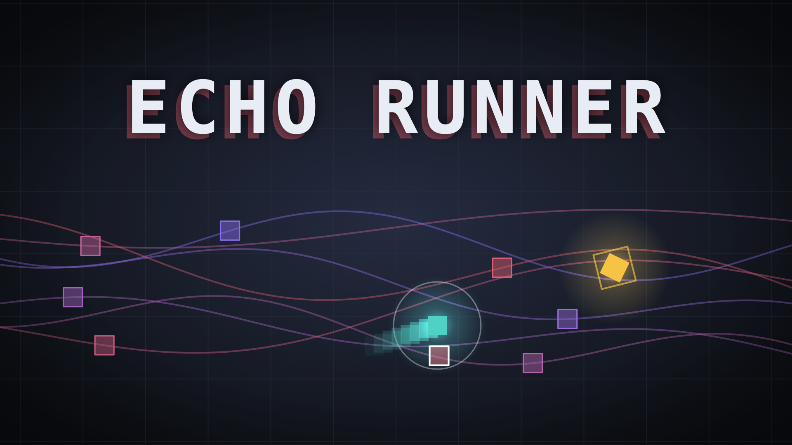
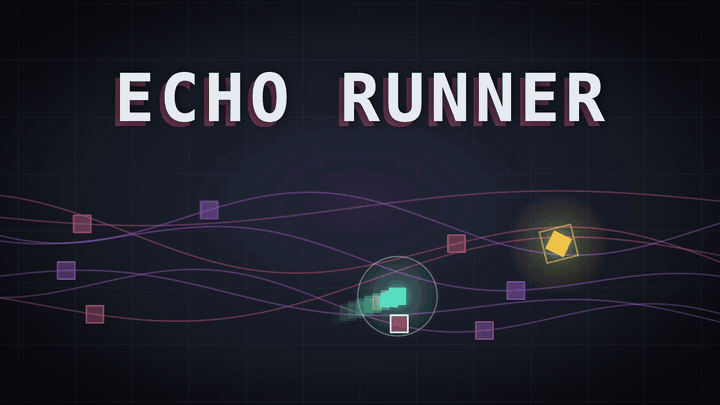
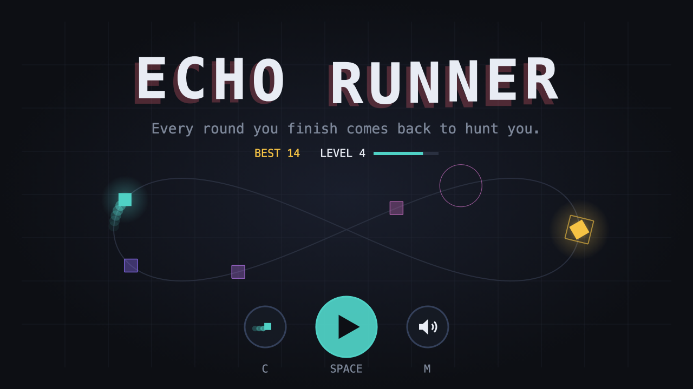
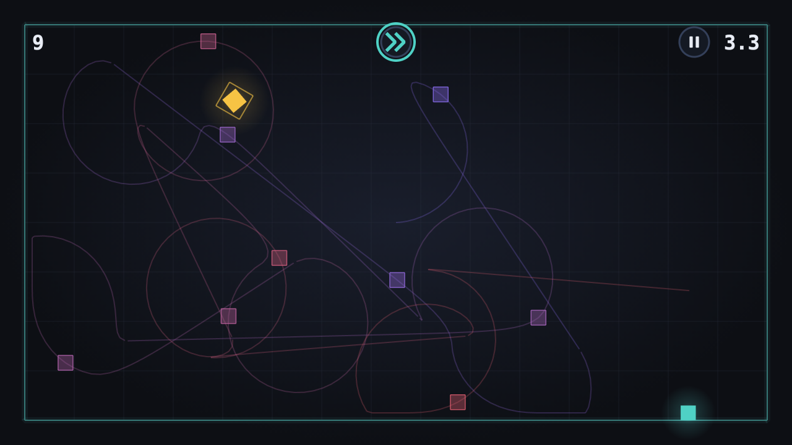
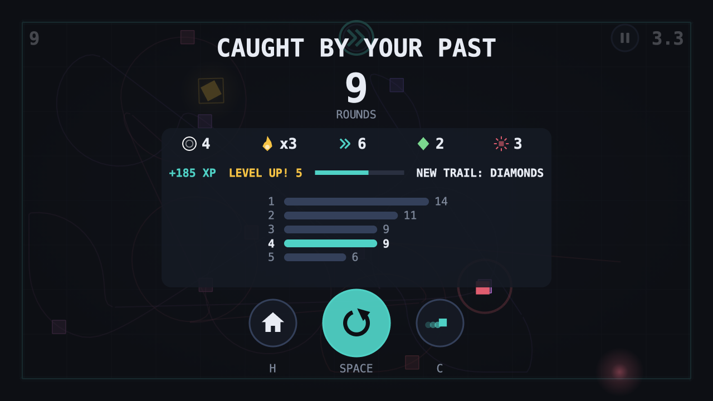
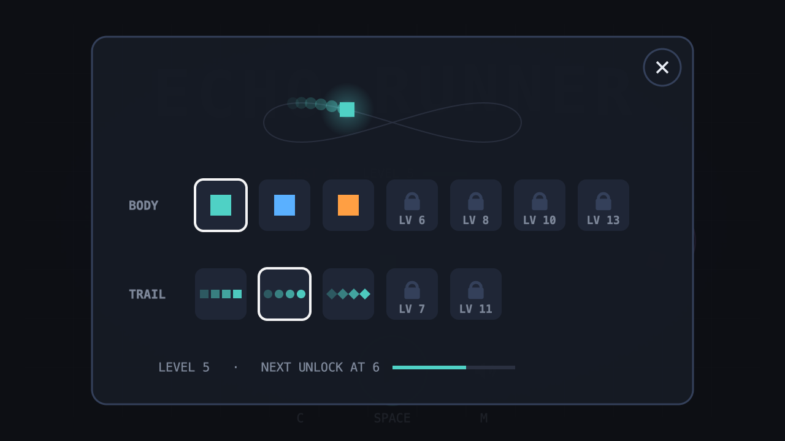
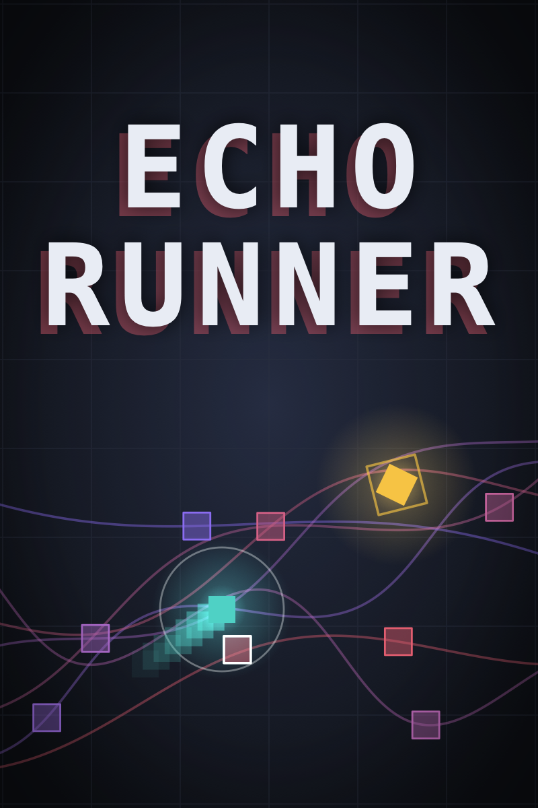
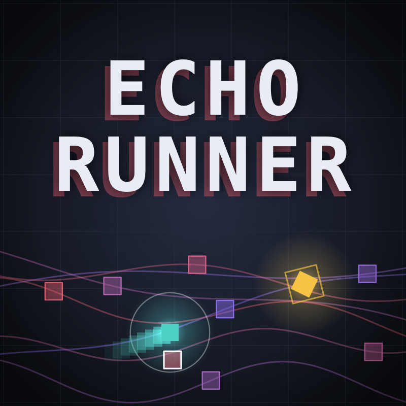

<div align="center">



# ECHO RUNNER

**Every round you finish comes back to hunt you.**

A single-screen arena game. Grab the target, and your run replays as a ghost that kills on touch.
Built with Phaser 3, TypeScript and Vite. No art files, no audio files: everything is drawn and synthesized in code.




<sub>[Full-quality landscape video](docs/videos/preview-landscape-1920x1080.mp4) · [portrait video](docs/videos/preview-portrait-1080x1620.mp4)</sub>

</div>

---

## How it plays

1. A golden target appears. Touch it and the round is won.
2. Everything you did that round is recorded, then **replayed as a ghost** from the start of every later round.
3. Touch a ghost and the run is over. Each round adds one more ghost, so the arena fills up fast.
4. The clock is tight and shrinks as you score, so there is never time to wait.

Your score is the number of rounds you survive.

## Features

| | |
|---|---|
| **Ghosts of your past** | Every earlier round replays at once, with a faint line showing its whole path so you can read where it is going. |
| **Dash and smash** | A burst of speed that also destroys any ghost you touch while it lasts. It recharges slowly... |
| **Close calls** | ...unless you slip past a ghost at the last moment. Each close call refunds a third of the dash, and quick ones chain into a combo with a climbing chime. |
| **Pickups** | `+TIME` adds seconds to the round, `ERASE` wipes the oldest half of your ghosts. They appear on the way to the target, so each one is a small detour. |
| **Music that grows** | A soft generated loop gains a hi-hat, a second melody and a kick as your run goes on, and drops back when you die. |
| **Unlockable looks** | XP from every run levels you up. Bodies (color) and trails (squares, dots, diamonds, sparks, prism) mix freely. |
| **Built for touch** | Drag to steer, a big BOOST button under the other thumb, icon menus, multi-touch. |
| **Sharp everywhere** | Rendered at 2x so text and shapes stay crisp on high-DPI screens. |

## Screenshots

<table>
  <tr>
    <td width="50%"><br><sub><b>Start screen</b>: a looping demo shows the idea.</sub></td>
    <td width="50%"><br><sub><b>Nine rounds in</b>: ghost paths crossing the arena.</sub></td>
  </tr>
  <tr>
    <td width="50%"><br><sub><b>Game over</b>: run stats, XP, level-up and your best runs.</sub></td>
    <td width="50%"><br><sub><b>Customize</b>: unlock bodies and trails as you level up.</sub></td>
  </tr>
</table>

<div align="center">
  
  &nbsp;&nbsp;
  
</div>

## Controls

| | Desktop | Touch |
|---|---|---|
| Move | `WASD` or arrow keys | Press and drag, like a joystick |
| Dash / smash | `Shift` | The round BOOST button |
| Pause | `P` | Pause icon |
| Sound | `M` | Sound icon |
| Restart | `Space` | Restart icon |
| Home / customize | `H` / `C` | Icons |

## Run it yourself

You need [Node.js](https://nodejs.org) (LTS).

```bash
npm install
npm run dev
```

Your browser opens on the start screen. To make a production build:

```bash
npm run build
```

That creates `dist/`. Upload its contents (with `index.html` at the root) to itch.io, CrazyGames or any static host.

## For developers

- **Tuning:** every gameplay number lives in [`src/game/constants.ts`](src/game/constants.ts). Playtest and tweak there first.
- **Debugging:** while `npm run dev` runs, type `scene` in the browser console (F12) to inspect the live game, e.g. `scene.score` or `scene.ghosts.length`.
- **Determinism:** the simulation runs at a fixed 60 Hz step and records one position per tick, so ghosts replay identically on every device.
- **Roadmap:** the milestone list and the rules of the game are in [`GAME.md`](GAME.md). Work on one milestone at a time.

```
src/
  main.ts            Phaser config (2x canvas, multi-touch)
  scenes/            StartScene (title, demo, locker) and GameScene (the run)
  game/              constants, recordings, progress/XP, skins, sound, UI icons, visuals
docs/                covers, screenshots and videos used by this page
```

---

<div align="center"><sub>Made with Phaser 3 · everything drawn in code · no files, no assets</sub></div>
